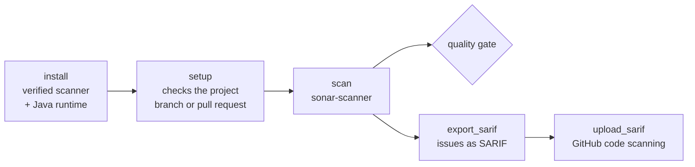

<div align="center">


# SonarQube for CircleCI and GitHub Actions

### Install the SonarScanner CLI, analyze branches and pull requests, and send SonarQube's issues to GitHub code scanning.

Install a checksum-verified [SonarScanner CLI](https://docs.sonarsource.com/sonarqube-server/latest/analyzing-source-code/scanners/sonarscanner/) with its own Java runtime, check the project's `sonar-project.properties`, analyze branches and pull requests on [SonarQube Server](https://www.sonarsource.com/products/sonarqube/), Community Build or SonarQube Cloud, gate on the quality gate, and export the issues as SARIF for GitHub code scanning, as orb commands or GitHub Actions.<br>
Runs on cimg/base, no Java needed · Branch and pull request analysis from CircleCI or GitHub Actions · Community Build detected · The token never on a command line<br>
SARIF export and GitHub code scanning upload, from any CI · Strict SHA-512 verification by default · Mirrors for air-gapped servers · No `sudo`

[](https://circleci.com/gh/juburr/sonarqube-orb)
[](https://github.com/juburr/sonarqube-orb/actions/workflows/actions.yml)
[](https://circleci.com/developer/orbs/orb/juburr/sonarqube-orb)
[](LICENSE)
[](https://discuss.circleci.com/c/ecosystem/orbs)


**[Quick Start](#-quick-start)** · **[Features](#-why-sonarqube-orb)** · **[Recipes](#-recipes)** · **[Commands](#-commands)** · **[GitHub Actions](#-github-actions)** · **[Security](#-secure-by-design)** · **[Network Access](#-network-access)**

<sub>An unofficial, community-maintained CircleCI orb and set of GitHub Actions, not affiliated with SonarSource. [Contributions are welcome!](#-contributing)</sub>

</div>

<br>

## ✨ Why sonarqube-orb?

<table>
<tr>
<td width="33%" valign="top">
📦 <b>A verified scanner, no Java needed</b><br><br>
<code>install</code> downloads SonarSource's Linux package for amd64 or arm64, with its own Java runtime, checks it against this orb's SHA-512 table, and puts it on the <code>PATH</code>. <code>cimg/base</code> is enough. Pin any release from 7.0.0 to 8.2.0, or mirror it in Artifactory.
</td>
<td width="33%" valign="top">
🌿 <b>Branches and pull requests, worked out</b><br><br>
<code>setup</code> reads CircleCI's or GitHub Actions' environment and hands <code>scan</code> the branch or pull request properties: no more appending to <code>sonar-project.properties</code>, and no trunk name to hard-code. Community Build, which refuses them, is detected and left alone.
</td>
<td width="33%" valign="top">
✅ <b>Checked before the scanner runs</b><br><br>
A missing properties file, an invalid project key, a <code>sonar.sources</code> that doesn't exist, a token committed to the file, a shallow clone, SonarQube Cloud without an organization: each is reported up front, with what to do.
</td>
</tr>
<tr>
<td width="33%" valign="top">
🔐 <b>The token stays secret</b><br><br>
The token reaches the scanner in its environment, never on its command line, where other processes could read it. A credential in <code>properties</code> or <code>extra_args</code> is refused, and the token only ever goes to a server over https (or to <code>localhost</code>).
</td>
<td width="33%" valign="top">
🚦 <b>The quality gate as a gate</b><br><br>
<code>quality_gate_wait</code> fails the job when the gate fails, and still exports the analysis' dashboard URL and task, so later steps can report on it. <code>verbose</code> turns on the scanner's debug output.
</td>
<td width="33%" valign="top">
🛡️ <b>SonarQube issues in GitHub code scanning</b><br><br>
<code>export_sarif</code> turns the analysis' unresolved issues into SARIF 2.1.0, and <code>upload_sarif</code> sends it to GitHub's code scanning API, from CircleCI or GitHub Actions, for github.com or GitHub Enterprise Server.
</td>
</tr>
</table>

### 🧩 The Orb vs. a Hand-Rolled Script

| | Hand-rolled | sonarqube-orb |
|---|---|---|
| Installing the scanner | `curl` and `unzip` a release, unverified | SHA-512 verified, cached, mirrored if you like |
| Java | an image with the right Java | the scanner's own runtime, on `cimg/base` |
| Branch and pull request analysis | `echo` into `sonar-project.properties`, trunk name hard-coded | `setup` reads CircleCI or GitHub Actions, the file untouched |
| Community Build | fails on branch properties | detected, and left out |
| The token | `-Dsonar.token=...`, visible in `ps` | the scanner's environment only |
| Quality gate | `sonar.qualitygate.wait` by hand | `quality_gate_wait`, with the reason when it fails |
| GitHub code scanning | not possible | `export_sarif` and `upload_sarif` |

## 🔄 How It Works



1. **`install`** puts a verified SonarScanner CLI, with its own Java runtime, on the `PATH`.
2. **`setup`** checks `sonar-project.properties` and the checkout, works out whether the build is for a branch or a pull request, and exports the properties that follow. It never changes the file.
3. **`scan`** runs `sonar-scanner` with them, the token in its environment, and waits for the quality gate if you ask it to.
4. **`export_sarif`** and **`upload_sarif`**, optionally, put the issues in GitHub code scanning.

## 🚀 Quick Start

### CircleCI

Add `SONAR_HOST_URL` and `SONAR_TOKEN` (a token from SonarQube, under **My Account > Security**) to a context, and:

```yaml
version: 2.1

orbs:
  sonarqube: juburr/sonarqube-orb@0.1.0

jobs:
  sonarqube:
    docker:
      - image: cimg/base:current
    steps:
      - checkout
      - sonarqube/install
      - sonarqube/setup
      - sonarqube/scan:
          quality_gate_wait: true

workflows:
  analyze:
    jobs:
      - sonarqube:
          context: sonarqube
```

The project needs a `sonar-project.properties` at the repository's root (or in `working_dir`), with at least its key:

```properties
sonar.projectKey=acme_web-app
sonar.sources=src
sonar.tests=test
```

### GitHub Actions

```yaml
jobs:
  sonarqube:
    runs-on: ubuntu-24.04
    env:
      SONAR_HOST_URL: ${{ vars.SONAR_HOST_URL }}
      SONAR_TOKEN: ${{ secrets.SONAR_TOKEN }}
    steps:
      - uses: actions/checkout@v7
        with:
          fetch-depth: 0  # SonarQube needs the history for blame and new code
      - uses: juburr/sonarqube-orb/actions/install@v0.1.0
      - uses: juburr/sonarqube-orb/actions/setup@v0.1.0
      - uses: juburr/sonarqube-orb/actions/scan@v0.1.0
        with:
          quality_gate_wait: "true"
```

## 🍳 Recipes

### Analyze Branches and Pull Requests

SonarQube Server Developer Edition and above, and SonarQube Cloud, analyze every branch and pull request separately. `setup` names them for the scan:

| Build | Properties `setup` exports |
|---|---|
| CircleCI, a branch with an open pull request (`CIRCLE_PULL_REQUEST`, or `CIRCLE_PR_NUMBER` from a fork) | `sonar.pullrequest.key`, `sonar.pullrequest.branch` |
| CircleCI, any other branch | `sonar.branch.name` |
| GitHub Actions, a `pull_request` event | `sonar.pullrequest.key`, `.branch` and `.base` (`GITHUB_BASE_REF`) |
| GitHub Actions, a push to a branch | `sonar.branch.name` |
| A tag | none: the analysis goes to the main branch |

CircleCI doesn't say which branch a pull request goes into, so `sonar.pullrequest.base` is left out and SonarQube uses the project's main branch, whatever it is called. Set `pull_request_base` when a pull request targets another branch. `branch_name`, `pull_request_key` and `pull_request_branch` replace what CI says.

This is what a hand-written setup step used to do by appending to `sonar-project.properties`:

```bash
# Before: changes the checked-out file, and assumes the trunk is master.
if [[ -n "${CIRCLE_PULL_REQUEST}" ]]; then
  echo "sonar.pullrequest.base=master" >> sonar-project.properties
  echo "sonar.pullrequest.key=${CIRCLE_PULL_REQUEST##*/}" >> sonar-project.properties
  echo "sonar.pullrequest.branch=${CIRCLE_BRANCH}" >> sonar-project.properties
else
  echo "sonar.branch.name=${CIRCLE_BRANCH}" >> sonar-project.properties
fi
```

`sonarqube/setup` replaces it: the same properties, passed to the scanner with `-D`, the base left to SonarQube unless you name it, and the same step working on GitHub Actions.

### Community Build

SonarQube Community Build analyzes the main branch only, and refuses branch and pull request properties. With `branch_analysis: auto`, the default, `setup` asks the server which edition it is (`api/navigation/global`, or the version without a token) and leaves them out. Every analysis then replaces the main branch's, so scan the main branch only:

```yaml
workflows:
  analyze:
    jobs:
      - sonarqube:
          context: sonarqube
          filters:
            branches:
              only: main
```

`branch_analysis: true` always sends them, and `false` never does. SonarQube Server Developer Edition and above can still detect a branch or pull request on its own on some CI services, such as GitHub Actions, whatever `setup` sends.

### SonarQube Cloud

Without a server URL, the scanner sends the analysis to SonarQube Cloud, which needs the organization's key:

```yaml
- sonarqube/setup:
    host_url: https://sonarcloud.io
- sonarqube/scan:
    host_url: https://sonarcloud.io
    properties: |
      sonar.organization=acme
```

A project in the US region uses `https://sonarqube.us`.

### Fail the Build on the Quality Gate

```yaml
- sonarqube/scan:
    quality_gate_wait: true
    quality_gate_timeout: "600"
```

The scan waits for the server to process the analysis, and fails when the gate does, with a link to it. It still exports `SONAR_DASHBOARD_URL` and `SONAR_CE_TASK_ID` first.

### Send the Issues to GitHub Code Scanning

```yaml
- sonarqube/scan:
    quality_gate_wait: true
- sonarqube/export_sarif:
    when: always
- sonarqube/upload_sarif:
    when: always
```

`export_sarif` waits for the server to process the analysis, reads the analyzed branch's or pull request's unresolved issues (`api/issues/search`, up to the 10,000 SonarQube returns) and writes `/tmp/sonarqube-reports/sonarqube.sarif`:

- **Each issue is a result** in the file it's in, relative to the repository's root, with its line and columns.
- **Its level comes from its severity:** blocker, critical and high are errors, major and medium warnings, the rest notes.
- **Security issues get a `security-severity`**, which GitHub sorts alerts by.
- **Each rule is named and linked** to its page on your server.
- **Alerts keep their identity between analyses:** each result is fingerprinted with SonarQube's hash of its line, so GitHub matches it from one analysis to the next, and between a branch and its pull requests.

`upload_sarif` sends it to `POST /repos/{owner}/{repo}/code-scanning/sarifs`, so it works from CircleCI too, for the build's commit and ref, and waits for GitHub to process it. It needs:

- **A GitHub token** in `GITHUB_TOKEN`: the `security_events` scope for a classic token, **Code scanning alerts: read and write** for a fine-grained one, or `permissions: security-events: write` for a GitHub Actions job's token.
- **Code scanning on the repository.** GitHub takes uploads for public repositories on github.com, and for private and internal ones, and GitHub Enterprise Server, only with **GitHub Code Security** (formerly GitHub Advanced Security) enabled. Without it, the upload fails with GitHub's 403 and what's missing.
- **A SonarQube user token** for `export_sarif`, whose user can browse the project and execute analysis. Project and global analysis tokens can only send analyses, so give `export_sarif` another `token` if the scan uses one.

For GitHub Enterprise Server, set `api_url: https://github.example.com/api/v3`. Security hotspots aren't issues, and aren't exported.

### Pin the Scanner, or Download It From a Mirror

```yaml
- sonarqube/install:
    version: 7.2.0
    download_base_url: https://artifactory.example.com/artifactory/maven-central
```

Any release in the [checksum table](#-checksum-verification) installs verified, given as `7.2.0` or SonarSource's full `7.2.0.5079`. A mirror is tried with SonarSource's paths, then Maven Central's, so a remote repository of either works. The checksum table, not the mirror, decides what is installed.

### Analyze a Project in a Subdirectory

```yaml
- sonarqube/setup:
    working_dir: services/api
- sonarqube/scan:
    working_dir: services/api
- sonarqube/export_sarif:
    working_dir: services/api
```

Paths in the SARIF file are made relative to the repository's root, from the base directory the scanner analyzed, whether `sonar-project.properties`, `properties` or `extra_args` set its `sonar.projectBaseDir`.

### Run the Analysis on the Scanner's Own Java

From SonarQube 10.6 (and on SonarQube Cloud), the scanner downloads a Java runtime from the server at the start of each analysis to run it on. `skip_jre_provisioning: true` uses the one installed with the scanner instead, for a server that can't provide one or a job that should download less. The server's analyzers must run on that release: the scanner comes with Java 17 up to 8.0.0 and Java 21 from 8.0.1.

## 🧰 Commands

| Command | What it does |
|---|---|
| [`install`](#sonarqubeinstall) | Installs the SonarScanner CLI, verified, with its own Java runtime |
| [`setup`](#sonarqubesetup) | Checks the project and works out branch or pull request analysis |
| [`scan`](#sonarqubescan) | Runs `sonar-scanner`, optionally waiting for the quality gate |
| [`export_sarif`](#sonarqubeexport_sarif) | Writes the analysis' unresolved issues as SARIF 2.1.0 |
| [`upload_sarif`](#sonarqubeupload_sarif) | Uploads a SARIF file to GitHub code scanning |

Every parameter that names a value (`version`, `host_url`, `properties` and the like) expands environment variables. Credentials are always the *name* of an environment variable (`token`, `github_token`), never the secret.

### `sonarqube/install`

| Parameter | Default | Description |
|---|---|---|
| `version` | `8.2.0` | Release to install, such as `7.2.0` or `7.2.0.5079` |
| `verify_checksums` | `strict` | `strict`, `known_versions` or `false` (see [Checksum Verification](#-checksum-verification)) |
| `install_path` | `~/.sonarqube-orb/sonar-scanner` | Directory for the whole release; its `bin` goes on the `PATH` |
| `download_base_url` | | An https mirror of binaries.sonarsource.com or Maven Central |
| `caching` | `true` | Cache the verified release between jobs |

### `sonarqube/setup`

| Parameter | Default | Description |
|---|---|---|
| `working_dir` | `.` | The project's base directory, with its `sonar-project.properties` |
| `properties_file` | `sonar-project.properties` | Another name is passed on as `project.settings` |
| `require_properties_file` | `true` | `false` for a project set up by parameters alone |
| `project_key` | | `sonar.projectKey`, in place of the file's |
| `host_url` | | The server, asked for its edition. Default: `SONAR_HOST_URL`, then the file's |
| `token` | `SONAR_TOKEN` | Variable holding the SonarQube token |
| `branch_analysis` | `auto` | `auto`, `true` or `false` (see [Community Build](#community-build)) |
| `branch_name` | | `sonar.branch.name`, in place of CI's |
| `pull_request_key` | | `sonar.pullrequest.key`, in place of CI's |
| `pull_request_branch` | | `sonar.pullrequest.branch`, in place of CI's |
| `pull_request_base` | | `sonar.pullrequest.base`. Default: `GITHUB_BASE_REF`, or the main branch |

It exports `SONARQUBE_ORB_PROPERTIES`, which `scan` reads.

### `sonarqube/scan`

| Parameter | Default | Description |
|---|---|---|
| `working_dir` | `.` | The project's base directory |
| `host_url` | | `sonar.host.url`. Default: `SONAR_HOST_URL`, then the file's, then SonarQube Cloud |
| `token` | `SONAR_TOKEN` | Variable holding the token, passed as the scanner's `SONAR_TOKEN` |
| `verbose` | `false` | The scanner's debug output (`-X`) |
| `quality_gate_wait` | `false` | Fail when the quality gate fails |
| `quality_gate_timeout` | `300` | Seconds to wait for it |
| `properties` | | More `key=value` properties, one per line, passed as `-D` |
| `extra_args` | | More `sonar-scanner` arguments, split like shell words |
| `java_opts` | | Java options, such as `-Xmx2g` |
| `skip_jre_provisioning` | `false` | Run the analysis on the scanner's own Java |
| `dashboard_url_env_var` | `SONAR_DASHBOARD_URL` | Variable to export the dashboard URL to |
| `task_id_env_var` | `SONAR_CE_TASK_ID` | Variable to export the server's task ID to |

It also exports `SONARQUBE_ORB_REPORT_TASK`, the path of the scanner's `report-task.txt`, which `export_sarif` reads.

### `sonarqube/export_sarif`

| Parameter | Default | Description |
|---|---|---|
| `working_dir` | `.` | The directory `scan` ran in |
| `host_url` | | The server. Default: `SONAR_HOST_URL`, then the scanner's report |
| `token` | `SONAR_TOKEN` | Variable holding a user token that can browse the project and execute analysis |
| `report_task_file` | | The scanner's `report-task.txt`. Default: the one `scan` exported |
| `wait_timeout` | `300` | Seconds to wait for the server to process the analysis |
| `category` | `sonarqube` | The analysis' category in code scanning, followed by the project's key |
| `max_issues_truncate` | `false` | Write the first 10,000 issues when there are more, instead of failing |
| `output_dir` | `/tmp/sonarqube-reports` | Where `<report_name>.sarif` goes |
| `report_name` | `sonarqube` | The file's name |
| `sarif_file_env_var` | `SONAR_SARIF_FILE` | Variable to export the file's path to |
| `store_artifacts` | `true` | Store `output_dir` as job artifacts |
| `when` | `on_success` | `always` to run after a failed quality gate |

### `sonarqube/upload_sarif`

| Parameter | Default | Description |
|---|---|---|
| `sarif_file` | | The file to upload. Default: the one `export_sarif` exported |
| `github_token` | `GITHUB_TOKEN` | Variable holding a GitHub token that can upload code scanning results |
| `repository` | | `owner/name`. Default: the build's |
| `api_url` | | GitHub's API. Default: `GITHUB_API_URL`, then `https://api.github.com` |
| `commit_sha` | | The commit. Default: `GITHUB_SHA` or `CIRCLE_SHA1` |
| `ref` | | `refs/heads/...`, `refs/tags/...` or `refs/pull/<n>/head`. Default: the build's |
| `wait` | `true` | Wait for GitHub to process it, and fail when it can't |
| `wait_timeout` | `120` | Seconds to wait |
| `when` | `on_success` | `always` to run after a failed quality gate |

## ⚡ GitHub Actions

Every command has a composite action of the same name, with the same inputs and defaults, running the same scripts:

| Action | Command |
|---|---|
| `juburr/sonarqube-orb/actions/install@v0.1.0` | `install` |
| `juburr/sonarqube-orb/actions/setup@v0.1.0` | `setup` |
| `juburr/sonarqube-orb/actions/scan@v0.1.0` | `scan` |
| `juburr/sonarqube-orb/actions/export_sarif@v0.1.0` | `export_sarif` |
| `juburr/sonarqube-orb/actions/upload_sarif@v0.1.0` | `upload_sarif` |

What one action exports, later steps see, as with CircleCI's `BASH_ENV`. A few differences:

- **Quote booleans and numbers** in `with:` (`quality_gate_wait: "true"`), since every input is a string.
- **Environment variables aren't expanded in inputs.** Use `${{ env.NAME }}` instead.
- **Set credentials in the environment** of the job or step: `token` and `github_token` name variables, as on CircleCI.
- **Give `actions/checkout` `fetch-depth: 0`.** Without the history, SonarQube can't blame lines or tell new code from old, and `setup` warns.
- **Use `if: always()` in place of `when`.**
- **A step that fails passes nothing on.** After a failed quality gate, `scan`'s exports don't reach later steps, so `export_sarif` reads the scanner's report from `.scannerwork/report-task.txt` itself: run it in the same `working_dir`.
- **Grant the job `permissions: security-events: write`** for `upload_sarif`, and pass it `GITHUB_TOKEN: ${{ github.token }}`:

```yaml
    permissions:
      contents: read
      security-events: write
    steps:
      # ... install, setup, scan
      - uses: juburr/sonarqube-orb/actions/export_sarif@v0.1.0
        if: always()
      - uses: juburr/sonarqube-orb/actions/upload_sarif@v0.1.0
        if: always()
        env:
          GITHUB_TOKEN: ${{ github.token }}
```

On a `pull_request` event, SonarQube Server Developer Edition and above also detects the pull request itself; `setup`'s properties say the same.

## 🔒 Secure by Design

- **Verified downloads.** The scanner is checked against this orb's SHA-512 table before anything is unpacked, and a cached copy is checked again.
- **No credentials on command lines.** The token reaches the scanner in its environment. API calls read their `Authorization` header from a private file, so `ps` never shows it. `properties` and `extra_args` that set `sonar.token`, `sonar.login` or `sonar.password` are refused.
- **Tokens over https only.** `setup`, `export_sarif` and `upload_sarif` send a token only over https, or to `localhost`. A server URL or mirror holding credentials is refused before it is printed.
- **Nothing executed from parameters.** `extra_args` is split like shell words, with nothing expanded or run, and a `$(...)` or backtick outside quotes is refused.
- **The checkout stays as it is.** `setup` never writes to `sonar-project.properties`, and prints its settings with every credential hidden.
- **No `sudo`.** Everything installs under `HOME`.

## 💻 Supported Platforms

- **Executors.** Linux on amd64 or arm64, with bash 4, curl or wget, and unzip (or bsdtar): `cimg/base`, CircleCI's machine images, and GitHub's Ubuntu runners. The scanner's Java runtime needs glibc, so Alpine images aren't supported.
- **Servers.** SonarQube Server, SonarQube Community Build and SonarQube Cloud, as the scanner release supports them. CI tests every command against Community Build 25.9 and 26.10, with scanner 7.0.0 and 8.2.0.
- **Extra tools.** `export_sarif` and `upload_sarif` also need jq; `upload_sarif` needs gzip and base64. `cimg/base` and GitHub's runners have all of them.

## 🔐 Checksum Verification

`install.sh` holds the SHA-512 of the Linux x64 and aarch64 packages of every SonarScanner CLI release from **7.0.0 to 8.2.0**. The table was built with `src/scripts/install_hash.sh`, which, for each package, requires:

1. **SonarSource's published SHA-256** for it, which must match.
2. **Maven Central's published SHA-256** for the same file, which must match too. Maven Central never replaces a published file, so it is a record independent of SonarSource's download site.
3. **A signature that verifies** with SonarSource's OpenPGP key, primary fingerprint `679F 1EE9 2B19 609D E816 FDE8 1DB1 98F9 3525 EC1A`.

SonarSource revoked the subkey that signed 7.0.0 through 8.0.0, giving the reason "Key has been compromised". It revoked it on 30 November 2025, and 8.0.0 was signed with it three days later. `install_hash.sh` reports this and doesn't count those signatures, so their entries rest on the two SHA-256 sums. 8.0.1 and later are signed with subkeys that are still valid.

| Mode | Listed version | Unlisted version |
|---|---|---|
| `strict` (default) | verified | fails before downloading anything |
| `known_versions` | verified | installed **unverified**, with a warning; give the full version, such as `8.3.0.6500` |
| `false` | not verified | not verified |

## 🌐 Network Access

| Host | When |
|---|---|
| `binaries.sonarsource.com`, then `repo1.maven.org` | `install`, unless `download_base_url` names a mirror, or the release comes from the cache |
| Your SonarQube server | `setup` (its edition, with `branch_analysis: auto`), `scan` (the analysis, the scanner's engine and, unless `skip_jre_provisioning`, a Java runtime) and `export_sarif` |
| `api.github.com`, or your GitHub Enterprise Server | `upload_sarif` |

## 🗺️ Not Yet Included

- **A ready-made job.** The commands fit in any job: the examples use `cimg/base`.
- **Caching the scanner's downloads** (`~/.sonar/cache`) between jobs.
- **Security hotspots in SARIF.** They aren't issues, so `api/issues/search` doesn't return them.
- **macOS and Windows executors.**

## 🤝 Contributing

```bash
# Lint
yamllint .
shellcheck src/scripts/*.sh src/scripts/lib/*.sh actions/*.sh tests/*.sh

# Offline tests (python3, jq, curl, git, zip)
for t in tests/*_test.sh; do bash "$t" || break; done

# Pack and validate
circleci orb pack src/ > orb.yml && circleci orb validate orb.yml

# Hash a new scanner release (after adding its build number to sq_scanner_builds in install.sh)
./src/scripts/install_hash.sh -v <version>
```

Pull requests run the offline tests, then every command against SonarQube Community Build on CircleCI (`.circleci/test-deploy.yml`) and every action on GitHub's runners (`.github/workflows/actions.yml`).

## 🎨 Logo

The logo is in [`assets/logos`](assets/logos), from 64 to 1024 pixels.

## 📜 License

[MIT](LICENSE). SonarQube and SonarScanner are trademarks of SonarSource SA; this project is not affiliated with SonarSource.
